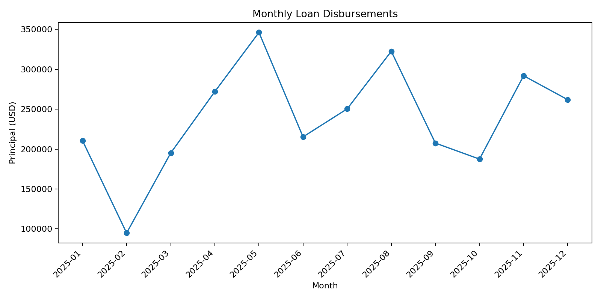
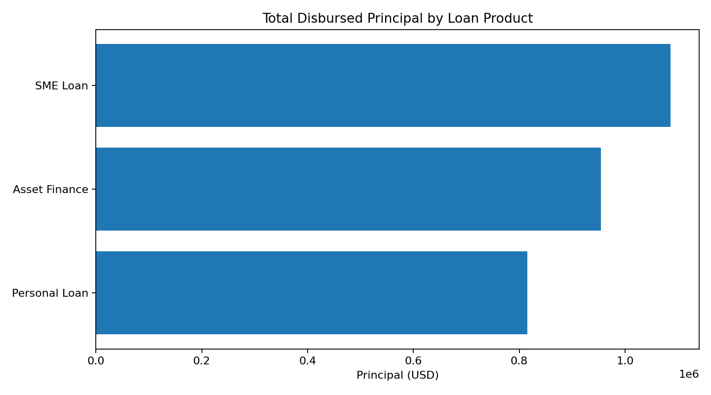

# Financial Data Analytics Portfolio — Synthetic Loan Portfolio

**Author:** Fidelis Mutsvauki  
**Focus:** Python, SQL, data quality, exploratory analysis, portfolio reporting

## Project overview
This project demonstrates an end-to-end analysis of a small loan portfolio using a fully synthetic dataset. It explores disbursement patterns, product mix, branch performance and illustrative default rates.

> **Important:** Every record is simulated for demonstration. This is not customer data, employer data, or evidence of real lending decisions. The risk score and default flag are synthetic teaching variables.

## Questions explored
1. How is the portfolio distributed by loan product and branch?
2. What are the monthly disbursement volumes and principal amounts?
3. How do illustrative default rates vary by product and branch?
4. Are there missing values, duplicate loan IDs, or invalid numeric values?

## Repository structure
- `data/synthetic_loan_portfolio.csv` — 300 synthetic loan records.
- `src/analysis.py` — data validation, summary tables and visualisations.
- `sql/portfolio_queries.sql` — SQL examples for common portfolio questions.
- `requirements.txt` — Python dependencies.

## Run locally
```bash
python -m pip install -r requirements.txt
python src/analysis.py
```
The script writes summary CSV files and PNG charts to an `outputs/` directory.

## Methods
- Pandas data loading and validation
- Duplicate and missing-value checks
- Grouped summaries and monthly aggregation
- Default-rate calculation
- Matplotlib visualisation

## Interpretation notes
The simulated default rates are designed only to demonstrate analytical methods. They should not be used to infer actual credit risk, estimate loss rates, or support lending decisions.

## Skills demonstrated
Python • pandas • SQL • data cleaning • exploratory data analysis • financial reporting • visualisation

# Financial Data Analytics Portfolio

Analysis of a loan portfolio using Python and SQL, covering data quality checks, product and branch summaries, and disbursement trends.

> **Note:** This project uses a **synthetic dataset of 300 loans**. The figures are illustrative and do not represent real company data.

## Data quality
All checks passed: 300 rows, 0 duplicate loan IDs, 0 missing cells, 0 invalid principal values, 0 invalid default flags.

## Key findings

**By product**

| Product | Loans | Total principal (USD) | Average loan (USD) | Illustrative default rate |
|---|---|---|---|---|
| Asset Finance | 46 | 954,528 | 20,751 | 4.3% |
| Personal Loan | 172 | 815,634 | 4,742 | 5.2% |
| SME Loan | 82 | 1,085,705 | ~13,240 | 9.8% |

- Personal Loans are the largest book by count (57% of loans) but the smallest tickets.
- SME Loans hold the most principal (about 38% of the total).
- Asset Finance has the largest average loan.

**By branch**

| Branch | Loans | Total principal (USD) | Illustrative default rate |
|---|---|---|---|
| Bulawayo | 54 | 509,002 | 5.6% |
| Gweru | 57 | 537,641 | 5.3% |
| Harare | 70 | 686,869 | 7.1% |
| Masvingo | 65 | 598,557 | 4.6% |
| Mutare | 54 | 523,799 | 9.3% |

- Harare is the largest branch by principal (about 24% of the total).
- Mutare has the highest illustrative default rate (9.3%) and Masvingo the lowest (4.6%).

- ## Monthly disbursements

| Month | Loans | Total principal (USD) |
|---|---|---|
| 2025-01 | 19 | 210,620 |
| 2025-02 | 15 | 94,761 |
| 2025-03 | 22 | 195,080 |
| 2025-04 | 22 | 272,057 |
| 2025-05 | 26 | 346,247 |
| 2025-06 | 30 | 215,304 |
| 2025-07 | 27 | 250,405 |
| 2025-08 | 31 | 322,579 |
| 2025-09 | 28 | 207,508 |
| 2025-10 | 24 | 187,429 |
| 2025-11 | 28 | 291,943 |
| 2025-12 | 28 | 261,933 |

- February was the weakest month (15 loans, about 95k). May had the highest principal (about 346k), and August had the most loans (31).
- Disbursements grew through the year: the second half had 166 loans and about 1.52M in principal, against 134 loans and about 1.33M in the first half (53% of total principal came in H2).
- Loan count and principal don't always move together. June had 30 loans but only about 215k in principal, which means a smaller average ticket that month.

## Charts








## Project structure
- `data/`: dataset
- `sql/`: SQL queries
- `src/`: Python analysis script
- `outputs/`: generated CSV summaries and charts

## Tools
Python (pandas, matplotlib), SQL, Google Colab, GitHub


